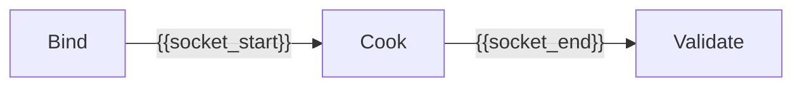

# {{slug}}

## 目的 / Goal

{{goal}}

**Kind:** `{{kind}}`  
**Status:** `draft`

## 非目标

- 不修改 `repos/` 业务代码以使管线「看起来过」
- 不提交 secrets / runs
- 不替代 OpenSpec 与 CI
- Agent 不宣布最终用户验收 P3 通过

## 配置指针

- `./config.yaml`
- `./secrets.local.yaml`（gitignore；按需）
- `./secrets.example.yaml`（按需）

路径约定见 [`pipelines/AGENTS.md`](../AGENTS.md)：`graphs/<domain>/<slug>/`。

## Sockets

| | |
|--|--|
| Start | {{socket_start}} |
| End | {{socket_end}} |
| Cook | {{cook}} |

## Context

- 标记：`pipeline_artifact`（或本图声明）
- 指纹：见 `config.yaml` / 本图 Validate
- 显示名：仅人读，禁止当唯一键
- 歧义：停止并问用户

## Cook chain

## 证据包

相对本次 `runs/<yyyy-MM-ddTHHmmss>/`：

| collector | required | sink |
|-----------|----------|------|
| summary | true | `summary.json` |
| report | true | `report.md` |

缺证仍写文件：`source: missing` / `count: 0`。可用 `_shared/cook_runtime`。

## Invoke

- 命令：`/run-pipeline {{domain}}/{{slug}}`
- Blender：见 `config.yaml` → `adapters.cook`（operator / API）
- 脚本：`./scripts/`（experimental Python；无则省略）

## Report / Gate

`report.md` 先给本次目的、执行范围、结果汇总与结论，再给关键 Evidence、失败说明、限制与下一步影响。FEV 另须给 Local / Aggregate Verdict、Observation / Interpretation / Unknown；不默认生成 acceptance 或等待人工 pass。使用 shared helper 时传 `fev={...}`。

Context 歧义或缺少必要用户输入时提出具体问题。业务 Graph 需要最终用户验收时，显式配置 `humanGates: [acceptance]`、acceptance collector，并传 `human_acceptance=True`；保留 `_template/acceptance.md` 作为该模式的可选模板。

## 判定级别

| 级 | 谁判 |
|----|------|
| P0–P2 | Agent，引用 Evidence |
| P3 | 仅 Graph 显式要求时由用户判定；FEV 不适用 |
