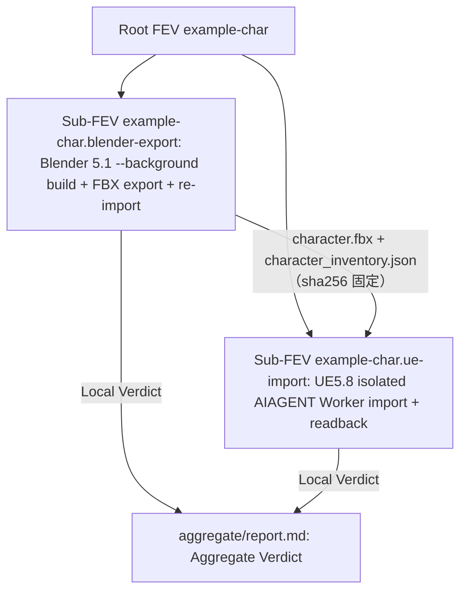

# example-character-export-fev

Kind: **Graph** · Status: **active** · Family: **probe** · Cook: **new-object** · Root FEV: `example-char`。

Goal：验证一个由脚本生成的 Blender 角色（armature + rigid skinned mesh + shape keys + material slots + 一个 action）能否由 Blender 5.1 headless 导出 FBX，再由 UE5.8 Editor Python 自动 import 为 native Skeleton / SkeletalMesh / MorphTarget / AnimSequence，且结构与 reference pose 保持一致。

本 Graph 是 `monospec-example` 的完整示例：输入不依赖任何外部资产，角色由 [`scripts/character_spec.py`](scripts/character_spec.py) 生成。

## 非目标

- 不做 rendering、shading、physics、Control Rig 或 retarget。
- 不修改 `repos/` 业务代码；production 实现由 OpenSpec change 交付，并由独立 ICD Graph 验收。
- 不提交 `runs/`；不生成 per-run acceptance；Local Verdict 不自动成为 Aggregate Verdict。

## Design source 与 Decision

- Design：[02-Pipeline设计](../../../../docs/2026-10-30-example-character-blender-ue5/02-Pipeline设计.md)，`implementation_authority: PIPELINE`。
- Decision 列表见 `config.yaml` → `fev.decisions`。

## Investigation Tree



| Sub-FEV | 目录 | Runtime | Question（全文见 `contract.yaml`） |
|---|---|---|---|
| `example-char.blender-export` | [sub-fev/blender-export](sub-fev/blender-export/investigation.md) | Blender 5.1 `--background`（当前用户，private process） | build + FBX export + re-import 是否保持 bones、rest heads、vertex count、shape keys、material slots 与 action length |
| `example-char.ue-import` | [sub-fev/ue-import](sub-fev/ue-import/investigation.md) | UE5.8 fresh AIAGENT Worker（`-NullRHI`，`fev_parallel` lease） | 自动 import 后 bones、reference pose、bone scale、MorphTarget、material slots 与 AnimSequence length 是否与 inventory 一致 |

`ue-import` 依赖 `blender-export` 的输出，因此按顺序执行。

## Sockets / Context

| | |
|---|---|
| Start | `probe-procedural-character-spec`：`character_spec.py`（sha256 记录在 manifest） |
| End | `probe-blender-ue5-character-export-verdict`：Local Verdict ×2 + Aggregate Verdict |
| Context | `config.yaml` → `context`；本机 Blender / UE / AIAGENT 设置来自 gitignored `.local/environment.yaml`（模板见 [`host_run/environment.example.yaml`](../../../_shared/host_run/environment.example.yaml)） |

## Invoke

在 repository root 执行（先完成 [local-environment](../../../../docs/local-environment/AGENTS.md) discovery 并填写 `.local/environment.yaml`）：

```powershell
python pipelines/graphs/example/example-character-export-fev/sub-fev/blender-export/scripts/run_blender_export.py --variant unit_cm
python pipelines/graphs/example/example-character-export-fev/sub-fev/ue-import/scripts/run_ue_import.py
```

`run_ue_import.py` 默认固定最新一个 pass 的 `blender-export` Run，也可用 `--source-run` 指定。每个脚本输出 `RUN=<path>`。脚本为 `experimental`，不进入业务代码。

## 证据包（每个 Sub-FEV Run）

| collector | required | sink |
|---|---|---|
| summary（checks + fev） | yes | `summary.json` |
| report（Question / Verdict / Observation / Interpretation / Limitations / Reproduction） | yes | `report.md` |
| provenance（repository state、graph hashes、input sha256、environment、lease、evidence hashes、Local Verdict） | yes | `manifest.json` |
| raw evidence | yes | `evidence/` |

`canonical/character_inventory.json` 是 canonical Run 的 tracked 副本（`runs/` gitignored），供 ICD Graph 读取；更新 canonical 时同步更新 aggregate report 与 ICD `config.yaml` 的 sha256。

## 判定

| Level | 内容 | 谁判 |
|---|---|---|
| P0 | 环境、版本、Worker owner / lease、exit code | Agent，引用 Evidence |
| P1 | 产物存在且非空 | Agent |
| P2 | 与 spec / inventory 的结构和数值比较 | Agent |
| Local / Aggregate Verdict | FEV §9 vocabulary | Sub-FEV / Root；Aggregate 见 [aggregate/report.md](aggregate/report.md) |

FEV 不设 P3 用户验收。
